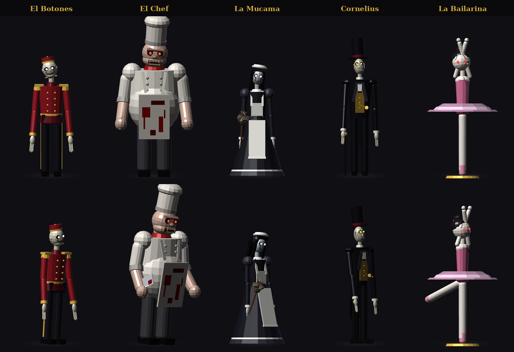

# Monstruos en 3D y correcciones de la rama `feature/3d-version`



## 1. Qué estaba roto

Los controladores 3D buscaban a los monstruos con datos que no existen:

| Código anterior | Qué pasaba | Ahora |
|---|---|---|
| `m.name == "El Botones"` | `name` es el nombre del nodo (`@Node@123`), nunca coincide | `m.key == "botones"` |
| `m.stage == 2` | la variable de estado se llama `s` | `m.at_gate_side()`, `m.s`, `m.location` |
| `m.target_cam` (Cornelius) | no existe | `m.location` |

Como la comparación del nombre nunca era verdadera, el juego no daba error, pero **ningún monstruo aparecía nunca** en la oficina 3D ni en las cámaras 3D.

Ahora los dos controladores usan los mismos datos que la versión 2D (`camera_view.gd`), así que lo que ves en 3D coincide con el estado real del juego:

- **Oficina** (`office_controller_3d.gd`): el Botones y el Chef aparecen en la reja donde estén (`at_gate_side()`), y los dos a la vez si coinciden. La Mucama asoma por la rejilla según `vent_rattle()`.
- **Cámaras** (`cctv_controller_3d.gd`): el Botones y el Chef aparecen en la sala de su `location`, en la posición de `cam_pos()`. Cornelius se esconde en las cámaras oscuras (4, 5 y 6) con los ojos apagados: solo se ven en el destello dorado (`glint_on`) o con el Flash. La Mucama avanza gateando por el ducto (Cam 07) según su `progress`. La Bailarina es una figurita sobre la cajita de música que gira mientras hay cuerda; al pararse la caja crece, se detiene, mira a la cámara y se le encienden los ojos rojos.

## 2. Otros arreglos

- **Luces de puerta (Q / E)**: apuntaban hacia dentro de la oficina. Ahora iluminan el pasillo, donde está el monstruo.
- **Los monstruos solo se ven bien con la luz de puerta**: la luz del techo, la lámpara y el monitor ya no los iluminan (están en la capa visual 2). En la oscuridad solo se distinguen la silueta y los ojos, como en FNAF.
- **Rejas**: eran una placa sólida que tapaba todo. Ahora son barrotes de ascensor tipo acordeón, así que se ve al monstruo detrás de la reja cerrada. Al abrirse suben por encima del marco y ya no tapan la cabeza.
- **Pasillos y ducto**: las puertas daban al vacío (el suelo se cortaba). Ahora hay un pasillo oscuro detrás de cada reja, con una luz de emergencia roja muy tenue al fondo, y un ducto metálico con lamas detrás de la rejilla de la pared de enfrente.
- **Luces de la oficina**: la lámpara del escritorio apuntaba a la pared de enfrente y dejaba una mancha con sombras duras; ahora ilumina la mesa. La luz del techo ya no proyecta sombras, porque en el renderer Compatibility dejaba rayas en las paredes.
- **Vistas 3D separadas**: la oficina y las cámaras compartían el mismo mundo 3D, y el Lobby (pedestal, Bailarina, alfombra) aparecía dentro de la oficina. Cada vista tiene ahora su propio mundo (`own_world_3d`) y solo se dibuja la que está en pantalla.
- **Texturas**: se dejan con la importación original. Activar la compresión VRAM (S3TC) en estas texturas grandes hacía que el editor de Godot 4.7 se cerrara al reimportarlas. Si quieren reducirlas, es más seguro bajar su resolución en un editor de imágenes.
- **Créditos y licencias** de los modelos de Sketchfab: ver `CREDITOS.md` (hay dos con licencia que no permite redistribuirlos en un repositorio público).

## 3. Jumpscares 3D

`scripts/3d/jumpscare_view_3d.gd` sustituye al jumpscare 2D cuando la versión 3D está activa (`USE_3D_OFFICE` en `night.gd`). Hay una coreografía para cada monstruo:

| Monstruo | Qué pasa |
|---|---|
| El Botones | Sale de la reja por la que llegó y se lanza con los brazos estirados, sacudiendo la cabeza. |
| El Chef | Corre hacia ti, levanta la cuchilla y la baja de golpe (sacudida y destello rojo). |
| La Mucama | Cae boca abajo desde el ducto del techo y se balancea delante de tu cara. |
| Cornelius | Oscuridad total con solo sus ojos dorados al fondo; luego aparece en tu cara con luz estroboscópica. |
| La Bailarina | Gira sin control, se frena en seco y se lanza gigante con la cabeza torcida. |

Los tiempos de cada fase están en las funciones `_anim_<monstruo>()`. El jumpscare 2D (`jumpscare_view.gd`) se sigue usando si se desactiva la versión 3D.

## 4. Cómo están hechos los modelos

| Archivo | Qué es |
|---|---|
| `scenes/3d/monsters/<key>_3d.tscn` | El modelo: nodos `MeshInstance3D` con primitivas de Godot (cápsulas, esferas, cilindros, cajas). Se puede abrir y editar en el editor. |
| `scripts/3d/monster_rig_3d.gd` | Animación por código: respiración, balanceo, tirones de cabeza, parpadeo y brillo de ojos. |
| `scripts/3d/monster_factory_3d.gd` | Crea el modelo de un monstruo a partir de su `key`. |

Convención de los modelos: origen en los pies, la cara mira a **+Z** y las medidas están en metros.

El script de animación busca los nodos por nombre: `Body`, `Head`, `ArmL`, `ArmR`, `EyeL` (su material controla el brillo de los ojos) y `EyeLight`. Si los editan, mantengan esos nombres.

### Usar un modelo propio (Blender, Sketchfab…)

Guarden el archivo como `assets/3d/monsters/<key>.glb` (`botones.glb`, `chef.glb`, `mucama.glb`, `cornelius.glb` o `bailarina.glb`), mirando a +Z y en metros. `monster_factory_3d.gd` lo usará automáticamente en lugar del modelo de primitivas. Un `.glb` no tendrá la animación ni el brillo de ojos, salvo que le pongan `monster_rig_3d.gd` como script raíz.

### Regenerar los modelos desde Python (opcional)

Los `.tscn` se generaron con `tools/modelos/` (Python 3 con numpy y Pillow):

```
cd nightshift/tools/modelos
python3 export.py          # reescribe scenes/3d/monsters/*_3d.tscn
python3 render.py preview.png   # vista previa sin abrir Godot
```

Las piezas, colores y medidas de cada monstruo están en `monsters.py`. **Ojo:** `export.py` sobrescribe los `.tscn`. Si alguien edita un modelo a mano en Godot, que deje de usar el script para ese modelo. La carpeta tiene un `.gdignore` para que Godot no la importe.

## 5. Pantallas de carga y transiciones

| Momento | Archivo | Qué hace |
|---|---|---|
| Al abrir el juego | `assets/ui/boot_splash.png` (en `project.godot`) | Imagen de arranque con el logo Art Déco. |
| Menú → noche, noche → menú | `scenes/loading.tscn` + `scripts/loading_screen.gd` | Carga la escena **en segundo plano** junto con los modelos 3D (`GameState.NIGHT_WARM`), así el juego ya no se congela al entrar. Muestra un indicador de piso de ascensor cuya aguja sube con el progreso, una barra dorada, el nombre de la noche y consejos de los monstruos de esa noche. Suena una campanita al terminar. |
| Inicio de cada noche | `scripts/night_intro.gd` | El reloj pasa de 11:59 PM a 12:00 AM con campanada, la pista se escribe letra a letra y aparecen las amenazas de la noche; las nuevas van iluminadas y con la etiqueta NUEVO. Cualquier tecla la salta. |
| Fin de la noche | `night.gd` → `_goto_result()` | Fundido a negro antes de la pantalla de resultado. |

Para cambiar de escena pasando por la carga: `GameState.start_night(n)`, `GameState.goto_menu()` o `GameState.goto_scene(ruta, recursos_extra, "night"/"menu")`.
